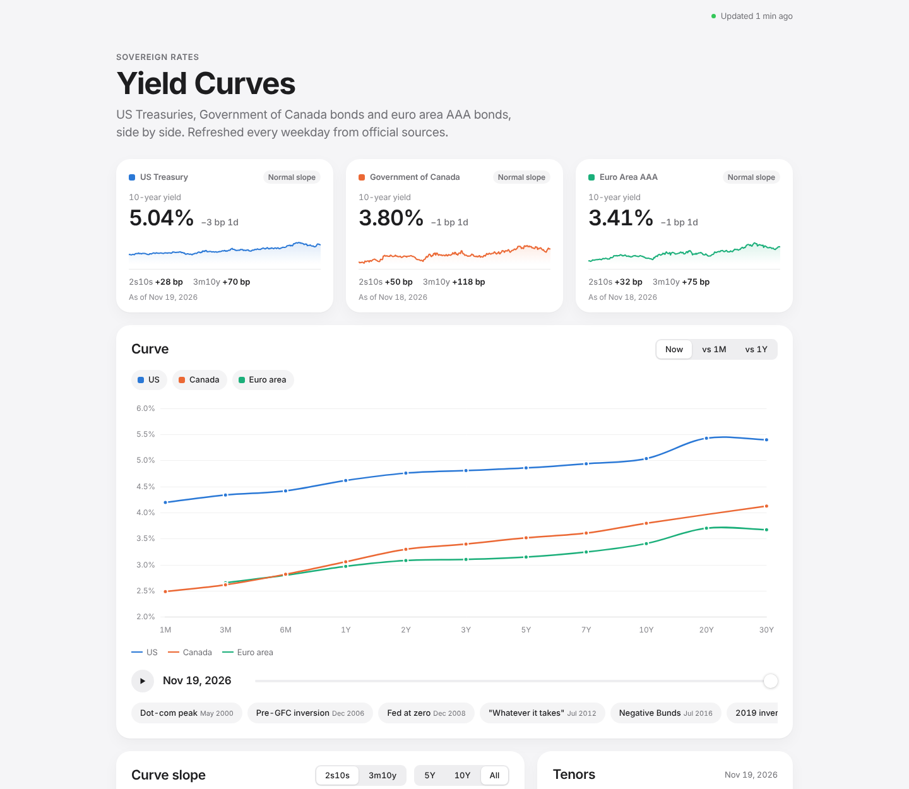

# Yield Curves

**US Treasuries, Government of Canada bonds and euro area AAA bonds, side by side.**

[](https://moezusb.github.io/yield-curve-monitor)


→ **[Open the live monitor](https://moezusb.github.io/yield-curve-monitor)**



---

## What it shows

- **Today at a glance**: 10-year yield, 1-day change, 1-year sparkline, 2s10s and 3m10y spreads, and an inversion flag for each market
- **Curve**: the full curve from 1 month to 30 years, with a scrubbable timeline back to 2000 and a play button
- **Compare**: overlay the curve from 1 month or 1 year earlier, with the change in bp for every tenor
- **Curve slope**: 2s10s or 3m10y history over 5 years, 10 years or since 2000, with US recessions (NBER) shaded. Tap a month to jump the curve there.
- **Notable moments**: one-tap jumps to the dot-com peak, the 2006 inversion, zero rates, the 2022 hiking cycle, the 2023 deep inversion and the first cuts

## Data sources

| Market | Source | Notes |
|---|---|---|
| US Treasury | [U.S. Treasury daily par yield curve](https://home.treasury.gov/resource-center/data-chart-center/interest-rates) | FRED used as a fallback if treasury.gov is unreachable |
| Government of Canada | [Bank of Canada Valet API](https://www.bankofcanada.ca/valet/docs) | T-bills for 1M to 1Y, benchmark bonds for 2Y to 10Y, long bond shown at 30Y. No 20Y benchmark exists. |
| Euro area | [ECB Data Portal, YC dataset](https://data.ecb.europa.eu/data/datasets/YC) | Fitted spot curve across AAA-rated euro area sovereigns, not a single country. Starts Sept 2004, no 1M point. |

All free, no API keys. Missing points are left blank rather than estimated.

## How it works

```
GitHub Actions (weekdays)                   GitHub Pages
scripts/fetch_yields.py  ──►  data/yields.json  ──►  index.html
  Treasury, Bank of Canada, ECB                 Chart.js, no build step
```

- A scheduled workflow (`.github/workflows/update-data.yml`) runs twice each weekday, fetches all three sources server-side and commits `data/yields.json` (month-end history since 2000 plus the last ~400 daily curves).
- The page reads that one file: instant load, no CORS proxy, no third-party dependency at view time.
- If a source is down, the last good data for that market is kept and flagged.

## Design

Rebuilt in 2026 with an Apple-style interface: system font stack, grouped cards, segmented controls, automatic light and dark mode. The three series colours were checked for colour-blind separation, and every chart has a legend and a tenor table so colour is never the only cue.

## Running locally

```bash
python scripts/fetch_yields.py   # writes data/yields.json (stdlib only)
python -m http.server            # open http://localhost:8000
```

## What I would build next

- More markets (UK gilts, JGBs, Bunds as a single-country comparison)
- Real yields and breakevens from TIPS and Real Return Bonds
- Butterfly (2s5s10s) and forward-rate views

---

*Independent side project. Part of a macro and energy markets series. See also: [Power Markets](https://moezusb.github.io/power-market-monitor).*
